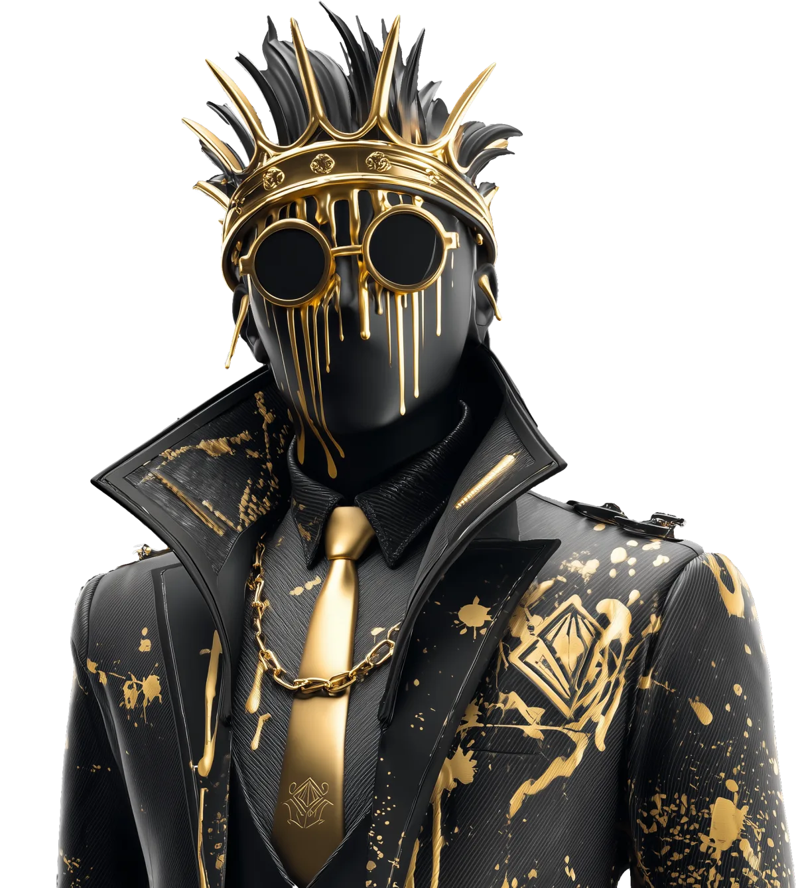
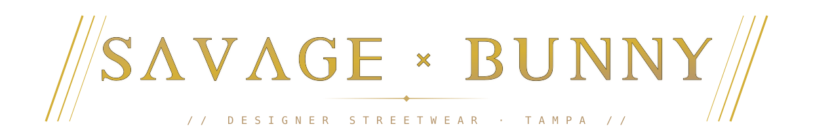

<!--
  ┌─────────────────────────────────────────────────────────────────────┐
  │  GENERATED FILE — do not edit this README by hand.                  │
  │  Edit  data/profile.json · data/properties.json · the template,     │
  │  then run:   node scripts/build-profile.mjs                         │
  │  (the GitHub Action rebuilds it automatically on push to main).     │
  └─────────────────────────────────────────────────────────────────────┘
-->

<div align="center">


<em>A one-founder house of brands — agents carry the work, the work funds the machine.</em>


<table>
  <tr>
    <td align="center" width="430" valign="top">
      <br/>
      <br/>
      <sub>PRODUCER · ENGINEER · THE ONE WHO SHIPS</sub>
    </td>
    <td align="center" width="430" valign="top">
      <br/>
      <br/>
      <sub>CHIEF QUALITY BENGAL · STUDIO ENFORCER</sub>
    </td>
  </tr>
</table>

<br/>

<p></p>

<table>
  <tr>
    <td align="center" valign="top" width="440">
      <a href="https://github.com/SAVAGE-STUDIO-INC"></a>
    </td>
    <td align="center" valign="top" width="440">
      <a href="https://github.com/SAVAGE-ROSTER"></a>
    </td>
  </tr>
  <tr>
    <td align="center" valign="top" width="440">
      <a href="https://github.com/SAVAGE-SUITE"></a>
    </td>
    <td align="center" valign="top" width="440">
      <a href="https://github.com/SAVAGE-CITY"></a>
    </td>
  </tr>
  <tr>
    <td align="center" valign="top" width="440">
      <a href="https://github.com/SAVAGE-BUNNY"></a>
    </td>
    <td align="center" valign="top" width="440">
      <a href="https://github.com/SAVAGE-CLIENTS"></a>
    </td>
  </tr>
  <tr>
    <td align="center" valign="top" width="440">
      <a href="https://github.com/GHOST-CROWN"></a>
    </td>
  </tr>
</table>


### The roster

| Property | Type | Live at | Status | House |
|:--|:--|:--|:--:|:--:|
| **SAVAGE CEO** | The desk | [savage.ceo ↗](https://www.savage.ceo) | 🟢 Live | [ROSTER](https://github.com/SAVAGE-ROSTER) |
| **Savage Studio** | Talent house | [savagestud.io ↗](https://savagestud.io) | 🟢 Live | [STUDIO](https://github.com/SAVAGE-STUDIO-INC) |
| **Savage Pay** | Payments | [pay.savagestud.io ↗](https://pay.savagestud.io) | 🟢 Live | [STUDIO](https://github.com/SAVAGE-STUDIO-INC) |
| **The Bay Lens** | Photography | [thebaylens.com ↗](https://www.thebaylens.com) | 🟢 Live | [STUDIO](https://github.com/SAVAGE-STUDIO-INC) |
| **Spanish Bunny** | Talent | [spanishbunny.com ↗](https://spanishbunny.com) | 🟢 Live | [ROSTER](https://github.com/SAVAGE-ROSTER) |
| **The Bengal** | Onyx HQ | [thebengal.zone ↗](https://www.thebengal.zone) | 🟢 Live | [ROSTER](https://github.com/SAVAGE-ROSTER) |
| **SAVAGE x BUNNY** | Streetwear | [savagexbunny.com ↗](https://savagexbunny.com) | 🟢 Live | [BUNNY](https://github.com/SAVAGE-BUNNY) |
| **Savage City** | The city | [savage.city ↗](https://savage.city) | 🟢 Live | [CITY](https://github.com/SAVAGE-CITY) |
| **Druids** | Members | [druids.vip ↗](https://www.druids.vip) | 🟢 Live | [CITY](https://github.com/SAVAGE-CITY) |
| **Goalpost** | Game | [goalpost.gg ↗](https://goalpost.gg) | 🟡 Building | [CITY](https://github.com/SAVAGE-CITY) |
| **Deep Productions** | Studio | [deep.productions ↗](https://deep.productions) | 🟢 Live | [CLIENTS](https://github.com/SAVAGE-CLIENTS) |
| **Lukas Rossi** | Artist | [lukasrossionline.com ↗](https://www.lukasrossionline.com) | 🟢 Live | [CLIENTS](https://github.com/SAVAGE-CLIENTS) |
| **3rd Charm** | Band | [3rd-charm.vercel.app ↗](https://3rd-charm.vercel.app) | 🟡 Building | [CLIENTS](https://github.com/SAVAGE-CLIENTS) |
| **Applegate** | Swim label | [applegate.vercel.app ↗](https://applegate.vercel.app) | 🟡 Building | [CLIENTS](https://github.com/SAVAGE-CLIENTS) |
| **The Machine** | Cockpit | the operation | 🔒 Private | [STUDIO](https://github.com/SAVAGE-STUDIO-INC) |
| **The Suite** | Engine | skin · kit · ledger | 🔒 Private | [SUITE](https://github.com/SAVAGE-SUITE) |

<sub>🟢 Live&nbsp;&nbsp;·&nbsp;&nbsp;🟡 Building&nbsp;&nbsp;·&nbsp;&nbsp;🔒 Private&nbsp;&nbsp;—&nbsp;&nbsp;names link to the live site.</sub>

<br/>

```text
╔═══════════════════════════════════════════════════════╗
║         ONE HOUSE · ONE DESK · ONE AESTHETIC          ║
║   MAIN IS SACRED · GATES BEFORE SHIP · MERGE OR DIE   ║
╚═══════════════════════════════════════════════════════╝
```

<br/>


<sub>SAVAGE CEO · THE ARCHITECT · TAMPA BAY, FL</sub>

<sub><b>SAVAGE CEO</b>&nbsp;&nbsp;·&nbsp;&nbsp;<a href="https://github.com/SAVAGE-STUDIO-INC">SAVAGE STUDIO</a>&nbsp;&nbsp;·&nbsp;&nbsp;<a href="https://github.com/SAVAGE-ROSTER">SAVAGE ROSTER</a>&nbsp;&nbsp;·&nbsp;&nbsp;<a href="https://github.com/SAVAGE-SUITE">SAVAGE SUITE</a>&nbsp;&nbsp;·&nbsp;&nbsp;<a href="https://github.com/SAVAGE-CITY">SAVAGE CITY</a>&nbsp;&nbsp;·&nbsp;&nbsp;<a href="https://github.com/SAVAGE-BUNNY">SAVAGE BUNNY</a>&nbsp;&nbsp;·&nbsp;&nbsp;<a href="https://github.com/SAVAGE-CLIENTS">SAVAGE CLIENTS</a>&nbsp;&nbsp;·&nbsp;&nbsp;<a href="https://github.com/GHOST-CROWN">GHOST CROWN</a></sub>

<p>
  <a href="https://github.com/savageceo"></a>
</p>

</div>
